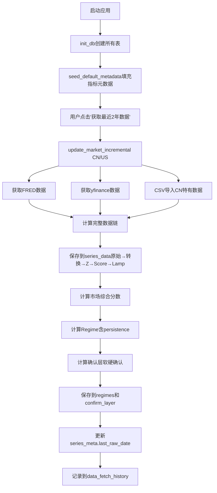
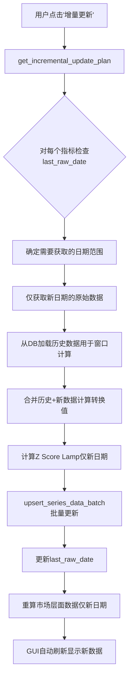
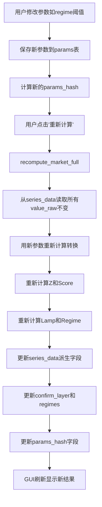

# 双市场温度计 - 增量数据库设计文档

## 📊 设计目标

1. **增量更新**：支持仅获取和存储新数据，避免重复下载
2. **完整持久化**：存储从原始数据到最终结果的所有中间步骤
3. **GUI解耦**：GUI仅从数据库读取，不参与计算逻辑
4. **参数重算**：修改参数后能快速重算派生数据而不重新获取原始数据
5. **数据溯源**：记录每条数据的来源和计算参数

---

## 🗃️ 数据库Schema详细设计

### 1. `series_meta` - 指标元数据表

存储所有指标的配置信息和状态。

```sql
CREATE TABLE series_meta (
    id INTEGER PRIMARY KEY AUTOINCREMENT,
    code TEXT UNIQUE NOT NULL,              -- 指标代码，如 'VIX_LOG', 'CN_MARGIN_SLOPE'
    name TEXT NOT NULL,                     -- 指标中文名称
    market TEXT NOT NULL,                   -- 'CN' 或 'US'
    role TEXT NOT NULL,                     -- 'main' | 'soft' | 'hard' | 'pair'
    direction TEXT NOT NULL,                -- 'up_good' | 'down_good'
    transform TEXT,                         -- 转换类型：'delta20', 'pct20', 'relret20', 'slope_20_60_ewma', 'log_winsor', 'raw'
    source TEXT NOT NULL,                   -- 'fred' | 'yfinance' | 'csv' | 'computed'
    source_symbol TEXT,                     -- 数据源的原始标识，如 '^VIX', 'RRPONTSYD'
    note TEXT,                              -- 备注说明
    
    -- 新增字段（增量更新支持）
    last_raw_date DATE,                     -- 最新原始数据日期（用于确定增量更新起点）
    last_updated TIMESTAMP,                 -- 最后更新时间戳
    data_quality TEXT DEFAULT 'unknown',    -- 'complete' | 'partial' | 'missing' | 'unknown'
    fetch_frequency TEXT DEFAULT 'daily',   -- 'daily' | 'weekly' | 'monthly'
    
    created_at TIMESTAMP DEFAULT CURRENT_TIMESTAMP,
    updated_at TIMESTAMP DEFAULT CURRENT_TIMESTAMP
);

CREATE INDEX idx_series_meta_market ON series_meta(market, role);
CREATE INDEX idx_series_meta_code ON series_meta(code);
```

**关键字段说明**：
- `last_raw_date`: 每次获取新数据后更新，下次增量更新从此日期+1开始
- `data_quality`: 用于GUI显示数据状态警告
- `source_symbol`: 存储原始API标识，便于调试和数据溯源

---

### 2. `series_data` - 时间序列数据表（核心表）

存储每个指标每个日期的**完整数据链**：原始值 → 转换值 → Z分数 → Score → 灯色。

```sql
CREATE TABLE series_data (
    id INTEGER PRIMARY KEY AUTOINCREMENT,
    series_id INTEGER NOT NULL,             -- 外键指向 series_meta.id
    date DATE NOT NULL,                     -- 数据日期
    view TEXT NOT NULL,                     -- 'daily' | 'weekly'
    
    -- 数据值（完整数据链）
    value_raw REAL,                         -- 原始值（从API获取的原始数据）
    value_transformed REAL,                 -- 转换后的值（经过delta20/pct20/slope等处理）
    z_score REAL,                           -- Z分数或MADZ分数
    score_0_100 REAL,                       -- 0-100分数
    lamp_color TEXT,                        -- 单指标灯色 'G' | 'Y' | 'R' | NULL
    
    -- 元数据
    is_derived BOOLEAN DEFAULT 0,           -- 是否派生数据（1=周数据从日数据派生，0=直接获取）
    params_hash TEXT,                       -- 计算参数的哈希值（用于检测参数变化）
    
    created_at TIMESTAMP DEFAULT CURRENT_TIMESTAMP,
    updated_at TIMESTAMP DEFAULT CURRENT_TIMESTAMP,
    
    FOREIGN KEY (series_id) REFERENCES series_meta(id),
    UNIQUE(series_id, date, view)           -- 确保同一指标同一日期同一视图只有一条记录
);

-- 关键索引（优化查询性能）
CREATE INDEX idx_series_data_lookup ON series_data(series_id, date, view);
CREATE INDEX idx_series_data_date ON series_data(date DESC);
CREATE INDEX idx_series_data_view ON series_data(view, date DESC);
```

**数据流示例**（以VIX为例）：
```
日期: 2024-11-07
value_raw: 16.23            ← 从yfinance获取的原始VIX值
value_transformed: 2.786    ← log(16.23)后winsorize的结果
z_score: -0.45              ← MADZ(40)计算结果
score_0_100: 45.5           ← 50 + 10*(-0.45) = 45.5
lamp_color: 'Y'             ← 因为 40 < 45.5 < 60，所以是Yellow
```

---

### 3. `confirm_layer` - 确认层详细数据表（新增）

存储每个市场每天的**软确认**和**硬否决**的详细组成。

```sql
CREATE TABLE confirm_layer (
    id INTEGER PRIMARY KEY AUTOINCREMENT,
    date DATE NOT NULL,
    market TEXT NOT NULL,                   -- 'CN' | 'US'
    view TEXT NOT NULL,                     -- 'daily' | 'weekly'
    
    -- 软确认组件（单灯色）
    soft_iwm_spy_lamp TEXT,                 -- IWM/SPY相对强度灯色（仅US）
    soft_hyg_ief_lamp TEXT,                 -- HYG/IEF相对强度灯色（仅US）
    
    -- 软确认组件（配对灯色）
    soft_twex_dxy_lamp TEXT,                -- TWEX/DXY配对灯色（US+CN共用）
    soft_cnh_cny_lamp TEXT,                 -- CNH/CNY配对灯色（US+CN共用）
    
    -- 软确认汇总
    soft_weighted_score REAL,               -- 加权分数 S = Σ(weight_i * value_i), value: G=2, Y=1, R=0
    soft_final_lamp TEXT,                   -- 软确认最终灯色（S≥1.6→G, S≤0.8→R, else→Y）
    
    -- 硬否决组件
    hard_etf_netflow_lamp TEXT,             -- CN宽基ETF 5日净流入灯色（仅CN）
    hard_hy_oas_jump_lamp TEXT,             -- HY OAS极端跳跃灯色（仅US）
    hard_vix_extreme_lamp TEXT,             -- VIX极值灯色（仅US）
    hard_veto_lamp TEXT,                    -- 硬否决结果（MIN with persistence）
    
    -- 最终结果
    final_lamp TEXT NOT NULL,               -- 最终灯色 = hard_veto_lamp=='R' ? 'R' : soft_final_lamp
    
    -- 元数据
    params_hash TEXT,                       -- 参数哈希（用于重算检测）
    persistence_applied BOOLEAN DEFAULT 0,  -- 是否应用了持续性过滤
    
    created_at TIMESTAMP DEFAULT CURRENT_TIMESTAMP,
    
    UNIQUE(date, market, view)
);

CREATE INDEX idx_confirm_layer_lookup ON confirm_layer(market, date, view);
```

**CN市场示例**：
```json
{
  "date": "2024-11-07",
  "market": "CN",
  "view": "daily",
  "soft_twex_dxy_lamp": "G",
  "soft_cnh_cny_lamp": "Y",
  "soft_weighted_score": 1.5,        // (0.5*2 + 0.5*1) = 1.5
  "soft_final_lamp": "Y",             // 因为 0.8 < 1.5 < 1.6
  "hard_etf_netflow_lamp": "G",
  "hard_veto_lamp": "G",              // MIN([G]) = G
  "final_lamp": "Y"                   // hard不是R，所以用soft的Y
}
```

**US市场示例**：
```json
{
  "date": "2024-11-07",
  "market": "US",
  "view": "daily",
  "soft_iwm_spy_lamp": "G",
  "soft_hyg_ief_lamp": "G",
  "soft_twex_dxy_lamp": "Y",
  "soft_cnh_cny_lamp": "Y",
  "soft_weighted_score": 1.6,        // (0.3*2 + 0.3*2 + 0.2*1 + 0.2*1) = 1.6
  "soft_final_lamp": "G",             // 因为 ≥1.6
  "hard_hy_oas_jump_lamp": "G",
  "hard_vix_extreme_lamp": "R",       // VIX极值触发
  "hard_veto_lamp": "R",              // MIN([G, R]) = R (with persistence)
  "final_lamp": "R"                   // 硬否决为R，最终就是R
}
```

---

### 4. `regimes` - 市场状态表

存储每个市场每天的**综合分数**、**Regime**和**最终灯色**。

```sql
CREATE TABLE regimes (
    id INTEGER PRIMARY KEY AUTOINCREMENT,
    date DATE NOT NULL,
    market TEXT NOT NULL,                   -- 'CN' | 'US'
    view TEXT NOT NULL,                     -- 'daily' | 'weekly'
    
    -- 市场综合数据
    market_score REAL NOT NULL,             -- 市场综合分数（主指标加权平均）
    regime TEXT NOT NULL,                   -- 'Attack' | 'Balanced' | 'Defense'
    
    -- 灯色（从confirm_layer同步，便于查询）
    lamp_soft TEXT,                         -- 软确认灯色
    lamp_hard TEXT,                         -- 硬否决灯色
    lamp_final TEXT NOT NULL,               -- 最终灯色
    
    -- Regime切换逻辑
    persistence_counter INTEGER DEFAULT 0,  -- 持续计数器（用于regime切换确认）
    regime_changed BOOLEAN DEFAULT 0,       -- 本日是否发生regime变化
    
    -- 元数据
    params_hash TEXT,                       -- 参数哈希
    
    created_at TIMESTAMP DEFAULT CURRENT_TIMESTAMP,
    
    UNIQUE(date, market, view)
);

CREATE INDEX idx_regimes_lookup ON regimes(market, date, view);
CREATE INDEX idx_regimes_market_view ON regimes(market, view, date DESC);
```

**字段说明**：
- `market_score`: 加权平均所有主指标的score_0_100，权重根据Attack/Balanced/Defense配置
- `persistence_counter`: 例如从Balanced变为Attack，需要连续3天（daily）或1周（weekly）≥70才正式切换
- `lamp_soft/lamp_hard`: 从`confirm_layer`同步过来，方便Overview图表查询

---

### 5. `indicator_weights` - 指标权重配置表（新增）

存储不同风格配置下的指标权重。

```sql
CREATE TABLE indicator_weights (
    id INTEGER PRIMARY KEY AUTOINCREMENT,
    market TEXT NOT NULL,                   -- 'CN' | 'US'
    profile TEXT NOT NULL,                  -- 'Attack' | 'Balanced' | 'Defense'
    indicator_code TEXT NOT NULL,           -- 指标代码
    weight REAL NOT NULL,                   -- 权重值（百分比，总和应为100）
    is_active BOOLEAN DEFAULT 1,            -- 是否启用该指标
    
    updated_at TIMESTAMP DEFAULT CURRENT_TIMESTAMP,
    
    UNIQUE(market, profile, indicator_code)
);

CREATE INDEX idx_weights_lookup ON indicator_weights(market, profile);
```

**预置数据示例**：
```sql
-- CN市场 Attack风格
INSERT INTO indicator_weights (market, profile, indicator_code, weight) VALUES
('CN', 'Attack', 'CN_MARGIN_SLOPE', 24.0),
('CN', 'Attack', 'CNH_PCT20', 16.0),
('CN', 'Attack', 'NORTH_TURNOVER_SHARE', 12.0),
('CN', 'Attack', 'CSI1000_OVER_300_REL20', 20.0),
('CN', 'Attack', 'PMI_NEWORDER_YOY_STD', 16.0),
('CN', 'Attack', 'CN_EPS_YIELD_MINUS_CGB10', 12.0);

-- US市场 Defense风格
INSERT INTO indicator_weights (market, profile, indicator_code, weight) VALUES
('US', 'Defense', 'RRP_D20', 18.0),
('US', 'Defense', 'TGA_D20', 12.0),
('US', 'Defense', 'HY_OAS', 24.0),
('US', 'Defense', 'VIX_LOG', 18.0),
('US', 'Defense', 'DFII10', 28.0),
('US', 'Defense', 'IWM_SPY_REL20', 0.0);  -- Defense风格不用小盘股
```

---

### 6. `params` - 参数配置表

存储全局参数配置的历史版本。

```sql
CREATE TABLE params (
    id INTEGER PRIMARY KEY AUTOINCREMENT,
    json_blob TEXT NOT NULL,                -- 参数JSON（包含所有阈值、窗口等）
    params_hash TEXT UNIQUE NOT NULL,       -- JSON的哈希值
    is_current BOOLEAN DEFAULT 0,           -- 是否当前使用的参数
    description TEXT,                       -- 变更说明
    
    created_at TIMESTAMP DEFAULT CURRENT_TIMESTAMP
);

CREATE INDEX idx_params_current ON params(is_current);
```

**JSON结构示例**：
```json
{
  "regime_thresholds": {
    "attack": 70,
    "defense": 40
  },
  "lamp_thresholds": {
    "green": 60,
    "red": 40
  },
  "persistence": {
    "daily_regime": 3,
    "weekly_regime": 1,
    "hard_veto_daily": 3,
    "hard_veto_weekly": 2
  },
  "z_windows": {
    "base": 60,
    "fast": 40,
    "slow": 90
  },
  "transforms": {
    "vix_winsor": {"p_low": 0.02, "p_high": 0.98},
    "margin_slope_ewma_lambda": 0.94
  },
  "soft_confirm_weights": {
    "US": {
      "IWM_SPY": 0.30,
      "HYG_IEF": 0.30,
      "PAIR_TWEX_DXY": 0.20,
      "PAIR_CNH_CNY": 0.20
    },
    "CN": {
      "PAIR_CNH_CNY": 0.50,
      "PAIR_TWEX_DXY": 0.50
    }
  },
  "pair_combine_rule": "A",
  "current_style_profile": {
    "CN": "Balanced",
    "US": "Balanced"
  }
}
```

---

### 7. `data_fetch_history` - 数据获取历史表

改进版的FetchLog，记录详细的数据获取信息。

```sql
CREATE TABLE data_fetch_history (
    id INTEGER PRIMARY KEY AUTOINCREMENT,
    timestamp TIMESTAMP DEFAULT CURRENT_TIMESTAMP,
    action TEXT NOT NULL,                   -- 'fetch' | 'import_csv' | 'backfill'
    status TEXT NOT NULL,                   -- 'success' | 'partial' | 'failed'
    message TEXT,                           -- 简短消息
    
    -- 详细信息
    indicator_code TEXT,                    -- 具体指标代码
    date_range_start DATE,                  -- 获取的日期范围
    date_range_end DATE,
    records_fetched INTEGER DEFAULT 0,      -- 总共获取的记录数
    records_updated INTEGER DEFAULT 0,      -- 实际更新的记录数（增量）
    records_skipped INTEGER DEFAULT 0,      -- 跳过的记录数（已存在）
    
    error_detail TEXT,                      -- 错误详情（JSON格式）
    duration_seconds REAL                   -- 执行耗时
);

CREATE INDEX idx_fetch_history_timestamp ON data_fetch_history(timestamp DESC);
CREATE INDEX idx_fetch_history_indicator ON data_fetch_history(indicator_code, timestamp DESC);
```

---

## 🔄 增量更新工作流

### 场景1：首次运行（空数据库）



### 场景2：每日增量更新



**关键优化**：
- 仅下载`last_raw_date + 1`到`today`的数据
- 窗口计算需要历史数据时从DB读取而非重新下载
- 使用批量upsert提高效率

### 场景3：参数修改后重算



**关键优化**：
- **不重新获取**原始数据（value_raw保持不变）
- 仅重新计算派生数据（transformed, z, score, lamp）
- 速度快，适合参数调优实验

---

## 📈 GUI数据查询接口

### Overview图表查询

```python
# 查询市场概览时间线
def load_market_overview(market: str, start_date, end_date, view: str) -> pd.DataFrame:
    """
    返回DataFrame包含：
    - date: 日期
    - market_score: 综合分数
    - regime: Attack/Balanced/Defense
    - lamp_final: 最终灯色
    - lamp_soft: 软确认灯色
    - lamp_hard: 硬否决灯色
    """
    query = """
    SELECT date, market_score, regime, lamp_final, lamp_soft, lamp_hard
    FROM regimes
    WHERE market = ? AND view = ? AND date BETWEEN ? AND ?
    ORDER BY date
    """
    # 用于绘制：
    # - Score时间线 (market_score)
    # - 背景色带 (regime)
    # - 底部灯色条 (lamp_final)
```

### 单指标详细图表查询

```python
def load_indicator_complete(indicator_code: str, start_date, end_date, view: str) -> pd.DataFrame:
    """
    返回DataFrame包含：
    - date: 日期
    - value_raw: 原始值（左Y轴）
    - value_transformed: 转换值（左Y轴，虚线）
    - z_score: Z分数（可选显示）
    - score_0_100: Score（右Y轴）
    - lamp_color: 灯色（色块）
    """
    query = """
    SELECT d.date, d.value_raw, d.value_transformed, d.z_score, d.score_0_100, d.lamp_color
    FROM series_data d
    JOIN series_meta m ON d.series_id = m.id
    WHERE m.code = ? AND d.view = ? AND d.date BETWEEN ? AND ?
    ORDER BY d.date
    """
    # 用于绘制：
    # - 双Y轴图表
    # - 阈值线 60/40
```

### 确认层详情查询

```python
def load_confirm_layer_detail(market: str, start_date, end_date, view: str) -> pd.DataFrame:
    """
    返回DataFrame包含所有软确认和硬否决组件的灯色
    """
    query = """
    SELECT date, 
           soft_iwm_spy_lamp, soft_hyg_ief_lamp, soft_twex_dxy_lamp, soft_cnh_cny_lamp,
           soft_weighted_score, soft_final_lamp,
           hard_etf_netflow_lamp, hard_hy_oas_jump_lamp, hard_vix_extreme_lamp,
           hard_veto_lamp, final_lamp
    FROM confirm_layer
    WHERE market = ? AND view = ? AND date BETWEEN ? AND ?
    ORDER BY date
    """
    # 用于绘制：
    # - 彩色时间线（每个组件一行）
    # - 加权分数图表
```

---

## 🎯 数据完整性检查

### 检查指标数据覆盖率

```python
def check_data_completeness(market: str, date_range: tuple, view: str) -> dict:
    """
    检查指定市场所有主指标的数据完整性
    
    返回示例：
    {
        'VIX_LOG': {
            'status': 'complete',
            'coverage_pct': 100.0,
            'missing_dates': [],
            'last_date': datetime(2024, 11, 7)
        },
        'CN_MARGIN_SLOPE': {
            'status': 'partial',
            'coverage_pct': 65.2,
            'missing_dates': [date1, date2, ...],
            'last_date': datetime(2024, 10, 15)
        }
    }
    """
    # 生成业务日历（交易日）
    expected_dates = get_business_days(date_range[0], date_range[1])
    
    # 对每个主指标查询实际数据日期
    for indicator in get_market_indicators(market, role='main'):
        actual_dates = query_dates_for_indicator(indicator.code, view)
        missing = set(expected_dates) - set(actual_dates)
        coverage = (len(actual_dates) / len(expected_dates)) * 100
```

### 生成增量更新计划

```python
def get_incremental_update_plan(market: str, target_date: datetime) -> dict:
    """
    分析哪些指标需要更新，更新多少天
    
    返回示例：
    {
        'VIX_LOG': {
            'start_date': datetime(2024, 11, 6),
            'end_date': datetime(2024, 11, 7),
            'days_to_fetch': 2,
            'reason': 'incremental_update'
        },
        'CN_MARGIN_SLOPE': {
            'start_date': datetime(2024, 10, 16),
            'end_date': datetime(2024, 11, 7),
            'days_to_fetch': 15,
            'reason': 'missing_data'
        }
    }
    """
    for indicator in get_market_indicators(market):
        last_date = get_last_data_date(indicator.code, 'daily')
        if not last_date:
            # 无数据，需要全量获取
            plan[indicator.code] = {
                'start_date': target_date - timedelta(days=730),  # 2年
                'end_date': target_date,
                'days_to_fetch': 730,
                'reason': 'initial_fetch'
            }
        elif last_date < target_date:
            # 有数据但不是最新，增量更新
            plan[indicator.code] = {
                'start_date': last_date + timedelta(days=1),
                'end_date': target_date,
                'days_to_fetch': (target_date - last_date).days,
                'reason': 'incremental_update'
            }
```

---

## 🚀 性能优化建议

### 1. 批量插入优化

```python
# 使用pandas to_sql批量插入，而非逐条INSERT
def upsert_series_data_batch(series_id: int, df: pd.DataFrame, view: str):
    """
    df包含列: [date, value_raw, value_transformed, z_score, score_0_100, lamp_color]
    """
    df['series_id'] = series_id
    df['view'] = view
    df['updated_at'] = datetime.now()
    
    # SQLite 3.24+支持UPSERT
    df.to_sql('series_data', con=engine, if_exists='append', index=False,
              method='multi', chunksize=1000)
    
    # 或使用INSERT OR REPLACE
    connection.execute("""
        INSERT OR REPLACE INTO series_data 
        (series_id, date, view, value_raw, value_transformed, z_score, score_0_100, lamp_color)
        VALUES (?, ?, ?, ?, ?, ?, ?, ?)
    """, df.values.tolist())
```

### 2. 索引策略

```sql
-- 复合索引加速常见查询
CREATE INDEX idx_series_data_series_date_view ON series_data(series_id, date DESC, view);

-- 覆盖索引（包含常用列，避免回表）
CREATE INDEX idx_series_data_complete ON series_data(series_id, date, view, value_raw, score_0_100);
```

### 3. 查询优化示例

```python
# BAD: 逐个查询每个指标
for indicator in indicators:
    data = query(f"SELECT * FROM series_data WHERE series_id = {indicator.id}")

# GOOD: 一次性JOIN查询所有指标
query = """
SELECT m.code, d.date, d.value_raw, d.score_0_100
FROM series_data d
JOIN series_meta m ON d.series_id = m.id
WHERE m.market = 'US' AND d.view = 'daily' AND d.date > ?
ORDER BY m.code, d.date
"""
# 然后在内存中按code分组
df = pd.read_sql(query, con=engine, params=[start_date])
grouped = df.groupby('code')
```

### 4. 数据分区（可选，数据量大时）

```sql
-- 按年份分区（手动实现，SQLite不原生支持分区）
CREATE TABLE series_data_2023 AS SELECT * FROM series_data WHERE date BETWEEN '2023-01-01' AND '2023-12-31';
CREATE TABLE series_data_2024 AS SELECT * FROM series_data WHERE date BETWEEN '2024-01-01' AND '2024-12-31';

-- 或使用ATTACH DATABASE分离历史数据
ATTACH DATABASE 'archive.db' AS archive;
CREATE TABLE archive.series_data_old AS SELECT * FROM main.series_data WHERE date < '2023-01-01';
DELETE FROM main.series_data WHERE date < '2023-01-01';
```

---

## 📝 总结

### 核心设计原则

1. **分离关注点**：
   - 原始数据（value_raw）与派生数据（transformed/z/score）分离存储但在同一行
   - 指标数据（series_data）与市场数据（regimes）分离
   - 确认层详情（confirm_layer）独立表存储

2. **增量友好**：
   - `last_raw_date`字段追踪最新数据
   - UNIQUE约束防止重复
   - UPSERT语义支持幂等更新

3. **可重算性**：
   - `params_hash`追踪计算参数
   - 原始数据不变，仅重算派生数据
   - 历史参数版本保留在`params`表

4. **GUI解耦**：
   - 所有GUI查询仅读取数据库
   - Repository提供高层次查询接口
   - 数据库是"单一真相来源"

5. **可追溯性**：
   - `data_fetch_history`记录所有数据获取
   - `source`字段标记数据来源
   - 错误详情JSON存储便于调试

### 下一步行动

完成阶段6开发后，您将拥有：
- ✅ 完整的增量数据库
- ✅ 灵活的参数重算能力
- ✅ 清晰的数据溯源
- ✅ GUI开发的坚实基础

阶段7-9的GUI开发将变得简单，因为所有数据都已在数据库中准备好！

